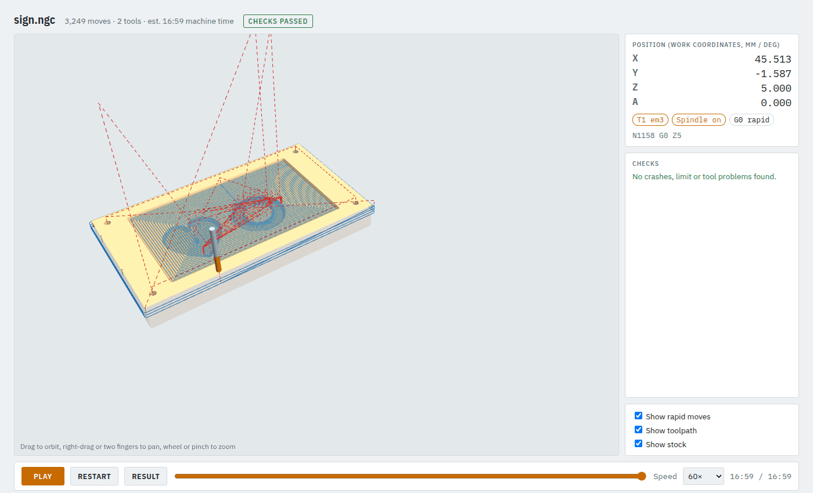
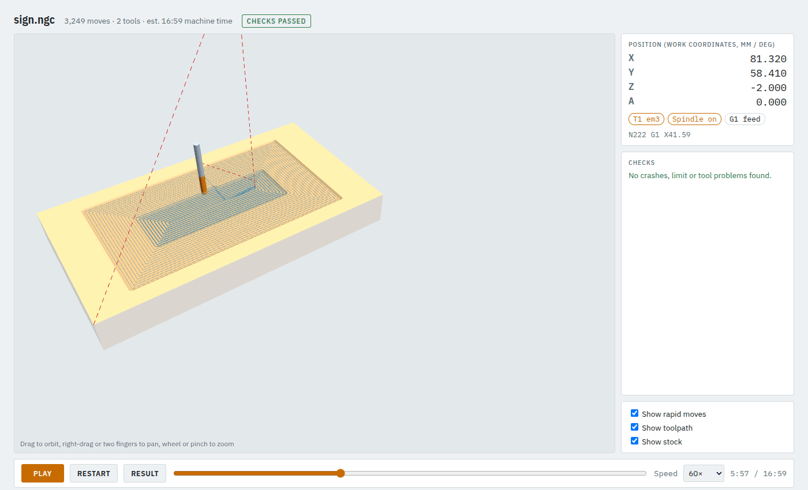
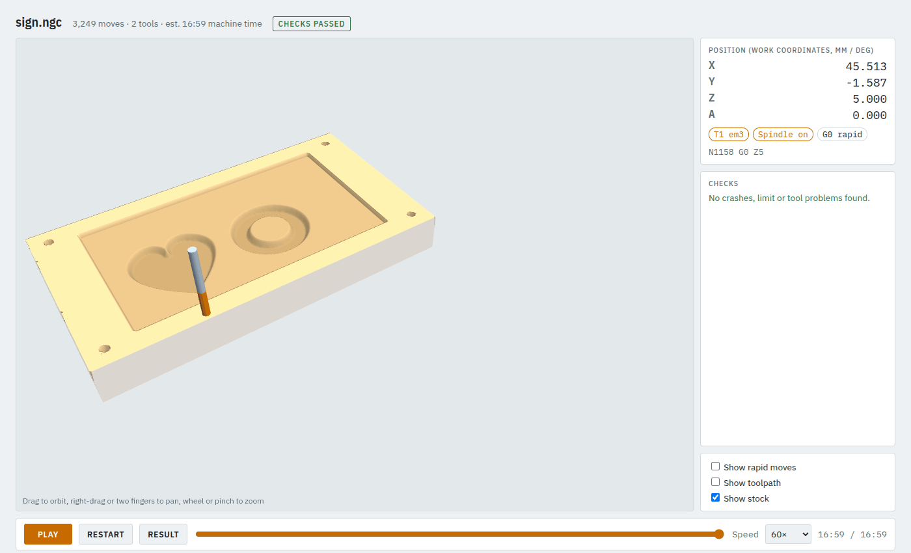

# 1. Your first job: check it, look at it, change it

You will take the sign example from job file to a checked LinuxCNC program: a pocket, a V-carved
drawing with a flat bottom, four drilled holes and an outside profile that cuts the panel free.

**You need:** the [setup](../MANUAL.md#2-setup) done once. **Time:** 10 minutes.

## Step 1: open a terminal in camcore

```bash
cd ~/cam_software/camcore
unset PYTHONPATH          # the ROS setup in your shell breaks camcore's Python otherwise
conda activate ./.conda
```

Do this in every new terminal. All tutorials assume you are in the `camcore` folder.

## Step 2: read the job

Open `examples/sign_job.json` in a text editor. Shortened:

```json
{
  "post": "linuxcnc",
  "tool_library": "tools.json",
  "stock": {"type": "box", "x": [0, 160], "y": [0, 90], "z": [-18, 0]},
  "defaults": {"safe_z": 5.0, "ramp_angle": 3.0},
  "shapes": {
    "panel":  {"type": "rect", "x": 0, "y": 0, "w": 160, "h": 90},
    "recess": {"type": "rect", "x": 20, "y": 10, "w": 120, "h": 70},
    "art":    {"type": "svg", "file": "sign.svg", "fit_origin": [30, 18]}
  },
  "operations": [
    {"op": "pocket",  "shape": "recess", "tool": "em3", "depth": 2, "step_down": 1},
    {"op": "vcarve",  "shape": "art", "tool": "v60", "top_z": -2, "max_depth": 3, "clear_tool": "em3"},
    {"op": "drill",   "tool": "em3", "points": [[8, 8], [152, 8], [152, 82], [8, 82]], "depth": 6, "peck": 2},
    {"op": "profile", "shape": "panel", "tool": "em3", "side": "outside", "depth": 6, "step_down": 2}
  ]
}
```

- **X0 Y0** is the front-left corner of the stock, **Z0** its top. Everything below the top is negative.
- **`stock`** is the block you clamp down: 160 x 90 mm, 18 mm thick. The check needs it to find crashes.
- **`shapes`** are named 2D outlines; **`operations`** cut them, in this order.
- **`tool: "em3"`** names a tool in `examples/tools.json` (a 3.175 mm end mill in ATC pocket 1).
- **`top_z: -2`** starts the V-carve on the floor of the 2 mm pocket cut before it.

## Step 3: check it (quick)

```bash
camcore check examples/sign_job.json -o out/sign --no-sim
```

```
camcore check examples/sign_job.json
machine: machine/printnc_provisional.json
verify: 3249 moves, 0 errors, 0 warnings
LinuxCNC sim: SKIPPED (--no-sim). Do not run this program on the machine.
wrote out/sign/sign_scene.json
wrote out/sign/sign.ngc
wrote out/sign/sign_view.html
PASSED WITHOUT SIM
```

`camcore check` makes the G-code, replays it on a model of your machine and the stock, and writes a
3D viewer. `--no-sim` skips the LinuxCNC simulator, so it takes seconds: use it while you work.

## Step 4: look at it

Open `out/sign/sign_view.html` in a web browser (double-click it in the file manager).



It opens on the result. The header says how many moves, how many tools, the estimated machine time
and whether the checks passed. On the right: the tool position, the current tool and G-code line,
and the list of problems (here: none).

- **Drag** to orbit, **right-drag** (or Shift-drag) to pan, **scroll** to zoom.
- **Play** runs the program with the material being removed; **Speed** sets the pace.
- **Drag the slider** to any point of the program. Here, a third of the way through, the pocket is cleared
  and the tool is at the first V-carve clearing pass:



- **Untick Show rapid moves and Show toolpath** to see only what the stock looks like when it is done:



## Step 5: change something

Make a copy so the example stays as it is, and edit the copy:

```bash
cp examples/sign_job.json examples/my_sign_job.json
```

In `examples/my_sign_job.json`, make the recess deeper and start the V-carve on its new floor:

```json
{"op": "pocket", "shape": "recess", ..., "depth": 3, ...},
{"op": "vcarve", "shape": "art", ..., "top_z": -3, ...},
```

Check again and reload the viewer:

```bash
camcore check examples/my_sign_job.json -o out/my_sign --no-sim
```

Prefer clicking to typing JSON? [Tutorial 2](02-desktop-app.md) does the same in the desktop app.

## Step 6: the final check, with the simulator

```bash
camcore check examples/my_sign_job.json -o out/my_sign
```

```
running the LinuxCNC sim (a few minutes for ~10000 moves)...
camcore check examples/my_sign_job.json
machine: machine/printnc_provisional.json
verify: 3249 moves, 0 errors, 0 warnings
LinuxCNC sim: OK
  line 1160, 187 s simulated run, OK
wrote out/my_sign/my_sign_scene.json
wrote out/my_sign/my_sign.ngc
wrote out/my_sign/my_sign_view.html
PASSED
```

(Your move count and times differ a little: they depend on your changes.) This runs the program
through real LinuxCNC in a Docker container, which takes a few minutes. Only
when the last line says **`PASSED`** (not `PASSED WITHOUT SIM`) is the program ready for the machine.

## What you have now

| File in `out/my_sign/` | What it is |
|---|---|
| `my_sign.ngc` | the program for the machine; only written if every check passed |
| `my_sign_report.txt` | what was checked and found; always written, also when the check fails |
| `my_sign_view.html` | the 3D viewer you just used |
| `my_sign_scene.json` | the machine model for the simulator GUI ([tutorial 12](12-simulator-and-machine.md)) |

**Only ever take programs from a `camcore check` output folder.** Anything else has not been checked.

Next: [the desktop app](02-desktop-app.md), or [what to do when a check fails](13-when-a-check-fails.md).
