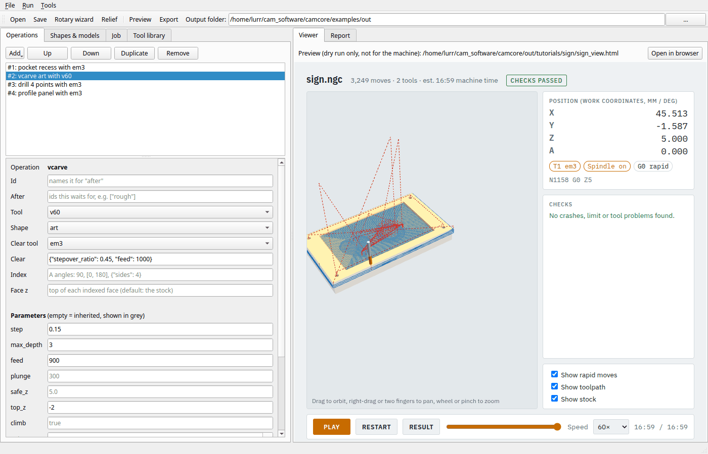
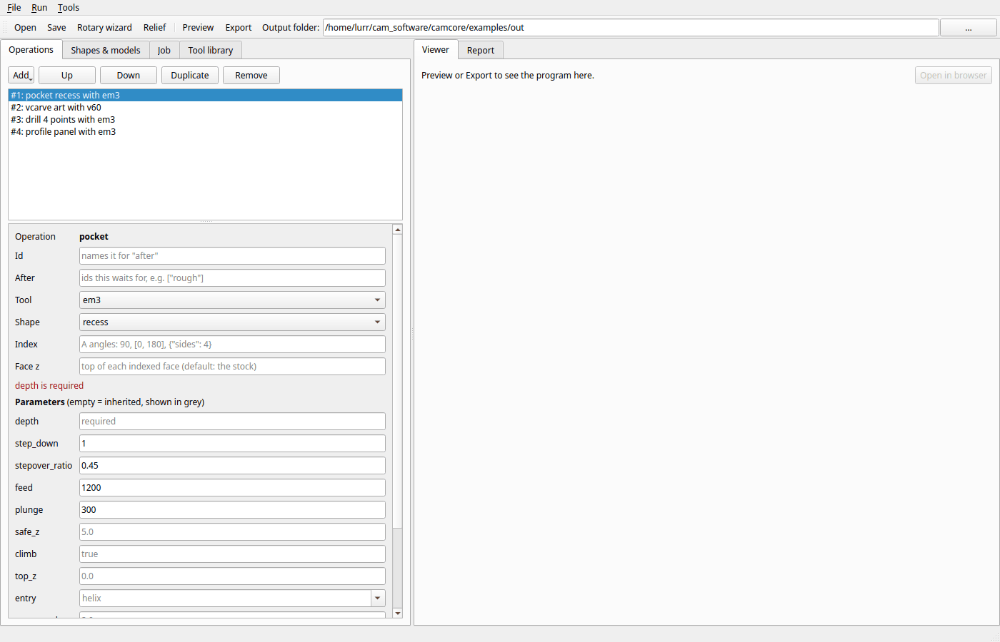
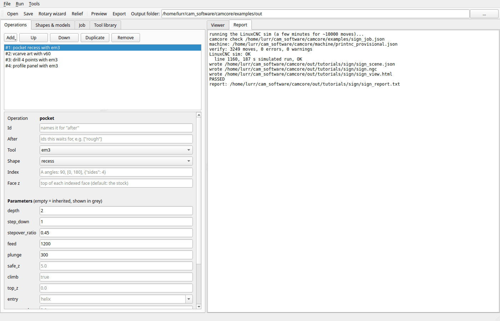
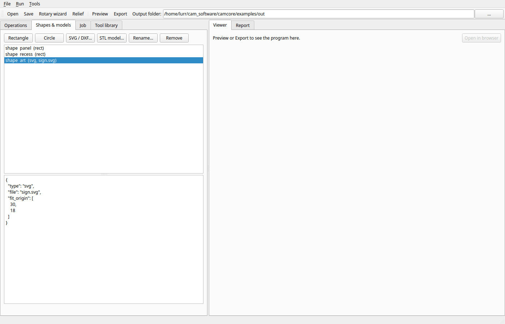
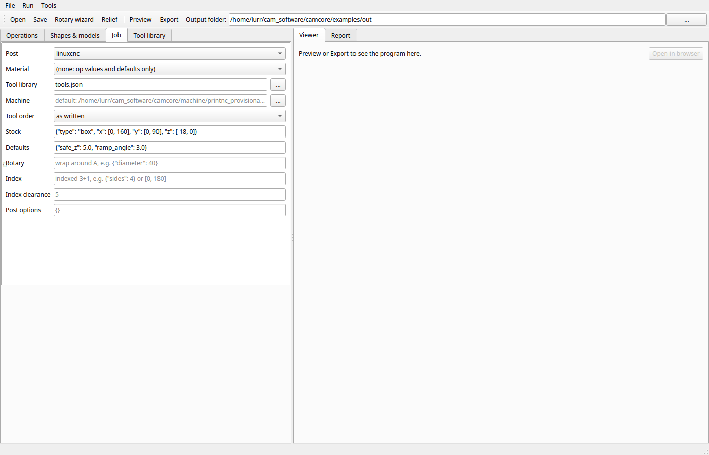
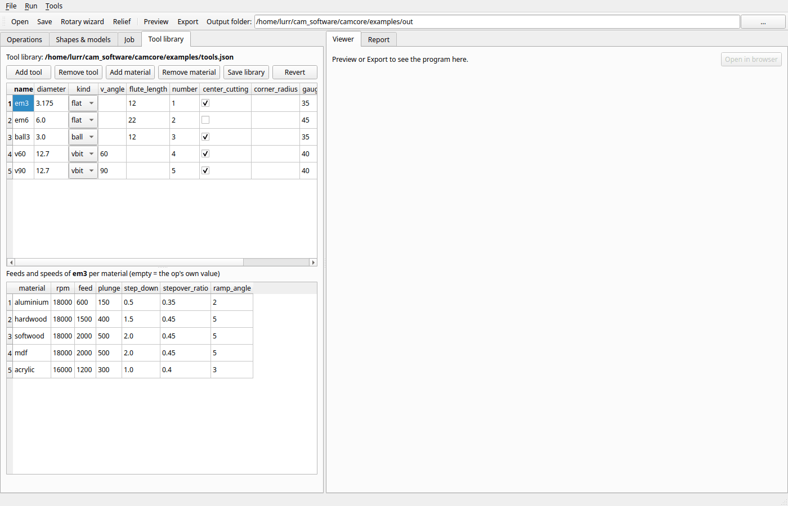

# 2. The desktop app: edit, preview, export

The desktop app is an editor for the same job files as [tutorial 1](01-first-job.md), with the 3D
viewer built in. It makes no toolpaths of its own: Preview and Export run `camcore check` on the
saved job, so everything you see in the app is what the checked program does.

**Time:** 15 minutes.

## Step 1: start it

```bash
camcore gui examples/sign_job.json      # or just `camcore gui` for a new, empty job
```



The window has two halves:

- **Left, editing:** the tabs **Operations**, **Shapes & models**, **Job** and **Tool library**.
- **Right, results:** the **Viewer** (the same 3D viewer as in tutorial 1) and the **Report** (the
  check's log).
- **Toolbar:** Open, Save, Rotary wizard ([tutorial 10](10-rotary-from-stl.md)), Relief
  ([tutorial 11](11-relief-designs.md)), **Preview**, **Export**, and the **Output folder** that Export
  writes to (default: `out/` next to the job).

## Step 2: change an operation

1. In the **Operations** tab, click **#2: vcarve art with v60**. Its form opens below the list.
2. Look at the **Parameters**. Fields with black text are set in the job. **Grey** text in an empty field
   is the value the operation gets anyway. Hover over it to see where from: the tool library's data for
   the job's material, the job's `defaults`, or the operation's built-in default.
3. Change **max_depth** from `3` to `2.5`. The window title gets a `*`: the job has unsaved changes.

To build the cutting order:

| Button | What it does |
|---|---|
| **Add** | a new operation (pick the kind from the menu); it is added at the end |
| **Up** / **Down** | move the selected operation in the order |
| **Duplicate** | copy it, e.g. to run the same profile with another tool |
| **Remove** | delete it |

## Step 3: problems show up while you type

Select **#1: pocket recess with em3** and empty its **depth** field. The app says at once, in red,
what would stop the job:



Type the `2` back in and the message goes away. An unknown tool, a missing shape or a key the
operation does not take show up here the same way.

## Step 4: preview (Ctrl+R)

Press **Ctrl+R** (or **Preview** in the toolbar). The app saves the job and runs the quick check
(no simulator) into a scratch folder. The **Report** tab shows the log while it runs:



When it passes, the **Viewer** tab opens on the result, as in the first picture. The caption says
*Preview (dry run only, not for the machine)*: a preview never writes anything to the output folder.
**Open in browser** shows the same viewer in a full browser window.

If the check fails, the Report says why and the viewer stays empty. See
[tutorial 13](13-when-a-check-fails.md).

The usual loop: change a value, Ctrl+R, look, repeat.

## Step 5: shapes and models



- **Rectangle**, **Circle**: add a shape and edit its numbers in the JSON box below the list.
- **SVG / DXF…**: import a drawing ([tutorial 3](03-own-drawings-and-cutouts.md)).
- **STL model…**: add a 3D model for 3D or rotary operations ([tutorials 7](07-3d-from-stl.md) and
  [10](10-rotary-from-stl.md)).
- **Rename…** also renames the shape in every operation that uses it.

The JSON box takes the same keys as the job file (see the
[shape reference](../MANUAL.md#9-job-file-reference)). Invalid JSON turns the box red and is not applied.

## Step 6: the job settings



| Field | What it sets |
|---|---|
| **Post** | `linuxcnc` for the PrintNC; `grbl` for a GRBL machine (no A axis) |
| **Material** | picks each tool's feeds and speeds from the tool library |
| **Tool library**, **Machine** | the files used; the machine defaults to `machine/printnc_provisional.json` |
| **Tool order** | *as written*, or *minimize changes* to group operations by tool |
| **Stock** | the block or bar you clamp; required |
| **Defaults** | values every operation inherits, e.g. `{"safe_z": 5.0}` |
| **Rotary**, **Index** | wrapped rotary ([tutorial 8](08-wrapped-rotary.md)) and indexed 3+1 ([tutorial 9](09-indexed.md)) |

## Step 7: the tool library



The top table is one row per tool: **number** is the ATC pocket and the LinuxCNC tool number. Click
a tool to see its feeds and speeds per material in the lower table. **Add tool**, **Add material**,
edit the cells, then **Save library**. The library is its own file (`examples/tools.json` here),
shared by every job that names it.

## Step 8: export (Ctrl+E)

Press **Ctrl+E** (or **Export**). This runs the full check *with* the LinuxCNC simulator into the
**Output folder**, which takes a few minutes. When it passes, the viewer caption says *Exported (sim
passed)* and the output folder holds the `.ngc` for the machine. If anything fails there is no `.ngc`,
only the report.

## Saving

**File → Save** (Ctrl+S) writes the job. **Save As…** to another folder adjusts relative paths
(the drawing, the tool library) so they still point at the same files.

Next: [your own drawings](03-own-drawings-and-cutouts.md).
