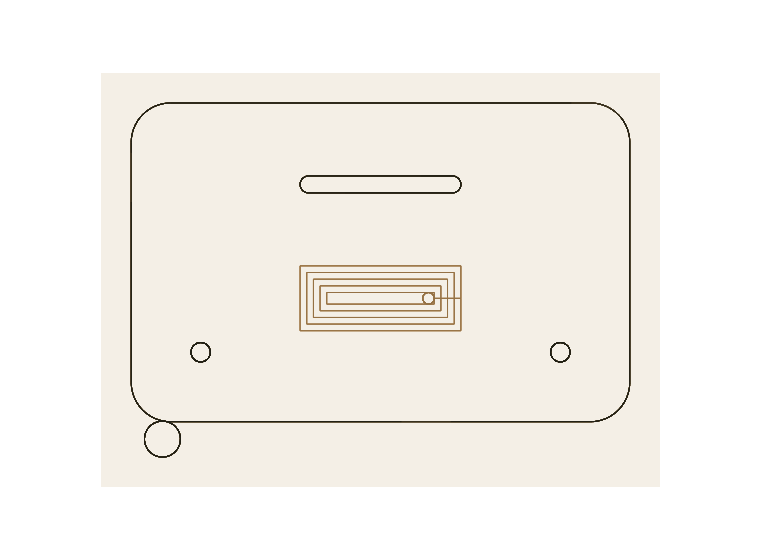
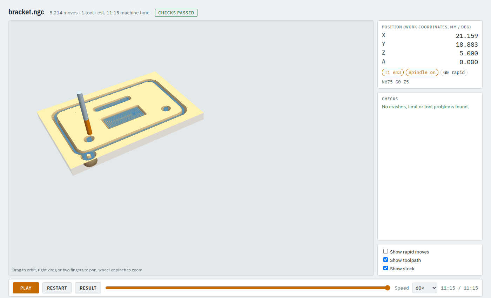
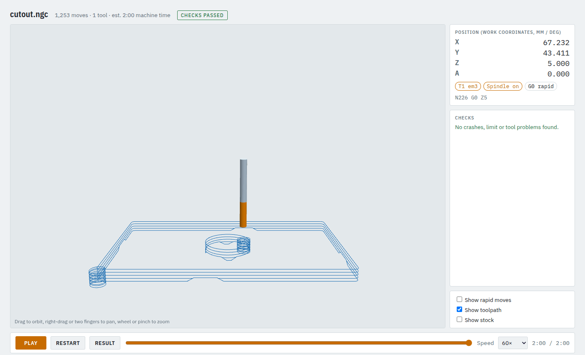

# 3. Your own drawing: pocket it and cut the part out

You will take a DXF from CAD, pocket one layer, cut the part out along another and hold it with
tabs. The example is `examples/bracket_job.json` with `examples/bracket.dxf`, a 6 mm aluminium bracket.

**Time:** 15 minutes.

## Step 1: prepare the drawing in CAD

camcore reads **DXF** (LINE, ARC, CIRCLE, (LW)POLYLINE, SPLINE, ELLIPSE, blocks) and **SVG** (paths,
basic shapes, transforms). Before you export:

- **Closed outlines only.** Every outline must close. A contour inside another one becomes a hole.
- **One layer per job step.** The bracket has the outline and its holes on layer `CUT` and the recess
  on layer `POCKET`. A layer `NOTES` with text is simply not used.
- **Text must be converted to curves** (outlines); DXF text, dimensions and hatches are ignored.
- **Units:** DXF takes them from the file (`$INSUNITS`); in SVG a `width`/`height` in mm (cm, in, pt)
  sets the scale, otherwise 1 unit = 1 mm.

## Step 2: the shapes

```json
"stock": {"type": "box", "x": [0, 100], "y": [0, 70], "z": [-6, 0]},
"shapes": {
  "part":   {"type": "dxf", "file": "bracket.dxf", "layers": ["CUT"],    "fit_origin": [10, 10]},
  "recess": {"type": "dxf", "file": "bracket.dxf", "layers": ["POCKET"], "fit_origin": [35, 22]}
}
```

**`fit_origin`** moves the lower-left corner of what was read to that point on the stock. The part
sits 10 mm in from the stock's front-left corner. Each layer has its own lower-left corner, so the
recess gets its own `fit_origin` to land where it is in the drawing.

In the app: **Shapes & models → SVG / DXF…**, pick the file, then set `layers` and `fit_origin` in the
JSON box.

## Step 3: the operations

```json
"material": "aluminium",
"operations": [
  {"op": "pocket",  "shape": "recess", "tool": "em3", "depth": 2},
  {"op": "profile", "shape": "part",   "tool": "em3", "side": "outside", "depth": 6.3,
   "lead_radius": 3, "tabs": {"count": 3, "width": 5, "height": 1}}
]
```

- **`"material": "aluminium"`** takes feed, plunge, step-down and stepover from the tool library's
  aluminium data for `em3`. Nothing else needs to be set.
- **`depth: 6.3`** goes 0.3 mm past the 6 mm stock so the part comes free cleanly.
- **`lead_radius: 3`** starts each pass on a small arc in the waste, so there is no mark on the part edge.
- **`tabs`**: three tabs, 5 mm wide, 1 mm high, left standing to hold the part until you cut it free.

Look at the plan from above without running a check:

```bash
camcore examples/bracket_job.json -o out/bracket.ngc --preview out/bracket_preview.svg
```



The pocket clears the recess in loops; the profile runs around the outline, the slot and the two
holes. The circle at the bottom left is the lead arc.

## Step 4: check it

```bash
camcore check examples/bracket_job.json -o out/bracket --no-sim
```

```
note: profile: contour at (81.6, 20.3) is milled out completely, no tabs needed
note: profile: contour at (81.6, 20.3) has no room for a lead arc, ramping in along it
...
verify: 5214 moves, 0 errors, 0 warnings
PASSED WITHOUT SIM
```

**Notes** say where an operation adapted itself. Here: the two holes and the slot are so small that the
3 mm cutter mills them out completely, so they need no tabs, and there is no room for a lead arc in
them, so the cut ramps in along the contour instead. Read the notes; they are also in the report.



## Step 5: the tabs up close

The simpler cutout example (`examples/cutout_job.json`, a plate with a round hole, 4 tabs) shows how
tabs are cut. With **Show stock** off and the view turned to look from the front, the profile passes
step down to 6.3 mm and lift over each tab:



Tabs are trapezoids: the tool rises over each tab and ramps back down after it, and only the passes
below the tab top are affected.

To put tabs where you want them instead of evenly spaced, give points on the part edge:

```json
"tabs": {"at": [[15, 10], [95, 10]], "width": 5, "height": 1}
```

Each point goes onto the nearest contour. A point on no contour, or tabs that overlap, are errors.

## Common choices

| You want | Use |
|---|---|
| Cut a part out | `profile`, `side: "outside"`, depth a little past the stock |
| A slot along a line, or an inside cutout | `profile`, `side: "on"` / `"inside"` |
| Clear an area | `pocket` (`stepover_ratio` around 0.4); for hard material [adaptive](05-adaptive-pocket.md) |
| Holes | `drill` with `points` and a centre-cutting tool |
| Two outlines combined | `{"type": "union", "shapes": [...]}`, `{"type": "difference", "a": ..., "b": ...}` |
| A mirrored copy | `{"type": "mirror", "shape": {...}, "axis": "y"}` |

All keys: [job file reference](../MANUAL.md#9-job-file-reference).

## If the drawing does not load

| Message | Fix |
|---|---|
| `... contour(s) don't close within 0.01 mm, e.g. an open end at (x, y)` | close the gap at that point in CAD; or raise `"join_tolerance"`; or `"ignore_open": true` to skip open pieces |
| `no closed contours found` | check the layer names in `layers` (case matters) |
| `unsupported DXF entity ...` | explode it in CAD, or put it on a layer you don't list |
| the part is the wrong size | check the DXF units or the SVG `width`/`height`; `"scale"` multiplies |

Next: [V-carving](04-vcarve.md).
