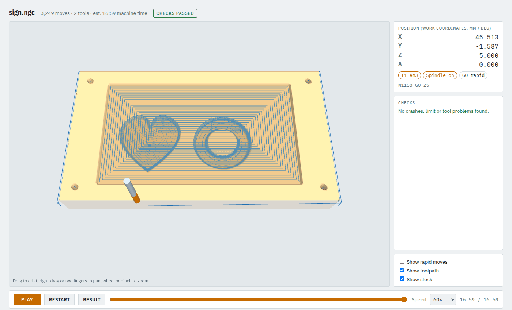
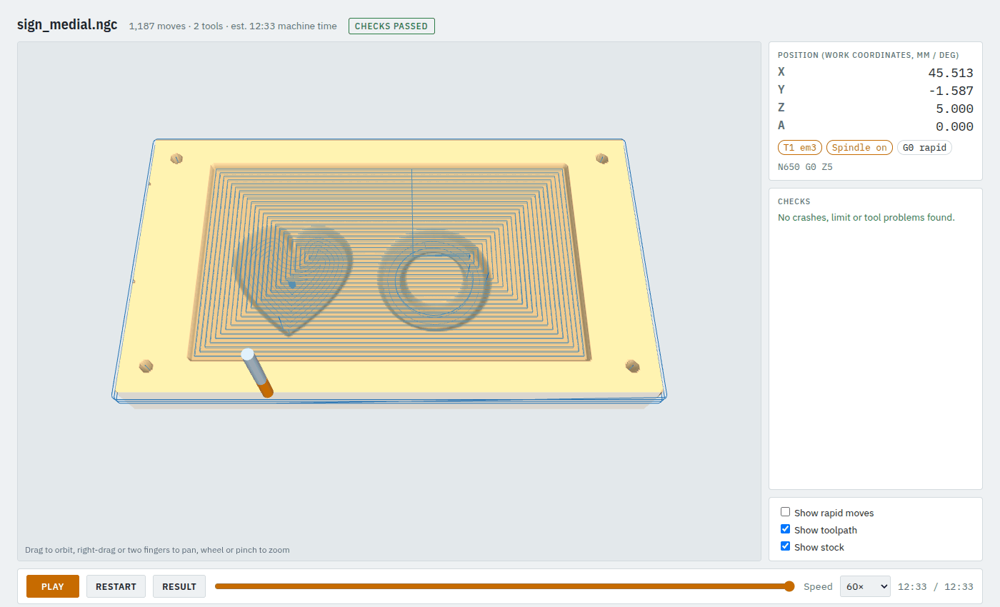

# 4. V-carving lettering and artwork

A V-bit cuts deeper where the drawing is wider, so narrow lines become fine grooves and corners
come out sharp. You will carve the sign drawing two ways and compare them.

**Time:** 10 minutes.

## Step 1: the drawing

Use closed outlines, as in [tutorial 3](03-own-drawings-and-cutouts.md). For lettering, convert the
text to curves in your drawing program first. The sign uses `examples/sign.svg` (a heart and a ring).

## Step 2: the operation

From `examples/sign_job.json`:

```json
{"op": "vcarve", "shape": "art", "tool": "v60", "top_z": -2, "max_depth": 3,
 "clear_tool": "em3", "clear": {"stepover_ratio": 0.45, "feed": 1000}}
```

- **`tool: "v60"`**: a 60° V-bit from the tool library (`"kind": "vbit"`, `"v_angle": 60`).
- **`max_depth: 3`**: the groove never goes deeper than 3 mm. Where the drawing is wider than the bit
  is at 3 mm (about 3.5 mm for a 60° bit), the bottom is flat.
- **`clear_tool: "em3"`**: an end mill clears those flat bottoms first, so the V-bit only cuts the walls.
  `clear` takes pocket parameters for that pass.
- **`top_z: -2`**: the carving starts on the floor of the 2 mm recess the job pockets first. Leave it
  out to carve from the stock top.

Without `max_depth` the depth is limited by the bit's size (where it is fully engaged). Without
`clear_tool`, wide areas are **not** cleared: the V-bit cuts only the walls down to the limit and the
middle stays standing at the top. Use `clear_tool` whenever the drawing has areas wider than the groove.

## Step 3: offset or medial

`vcarve` has two methods:

| | `"method": "offset"` (default) | `"method": "medial"` |
|---|---|---|
| How | loops stepping in from the outline, each one deeper | one path along the centre line of each stroke |
| Corners | very slightly rounded (by `step`, 0.1 mm) | sharp |
| Moves (the sign) | 3,249, 17 min | 1,187, 12.5 min |
| Needs | any V-bit | a centre-cutting V-bit and `"entry": "plunge"` |

Check both and compare them in the viewer, looking from above:

```bash
camcore check examples/sign_job.json -o out/sign --no-sim
camcore check examples/sign_medial_job.json -o out/sign_medial --no-sim
```

Offset: the V-carve paths in the heart and ring are many loops.



Medial: one path along the middle of each stroke, deepest where the stroke is widest.



The medial job differs from the offset one in two keys only:

```json
{"op": "vcarve", "shape": "art", "tool": "v60", "method": "medial", "entry": "plunge", ...}
```

The tool library must mark the bit `"center_cutting": true`, or the check refuses the plunges.

## Tips

- **Pick the bit for the size.** A 60° bit makes deeper, narrower grooves than a 90° bit for the same
  drawing; a 90° bit suits large, shallow lettering.
- **Thin lines stay shallow.** A 0.5 mm line is only about 0.4 mm deep with a 60° bit. That is right
  for a V-carve; make the line wider if it should be deeper.
- **Accuracy:** offset `step` (default 0.1 mm), medial `tolerance` (default 0.01 mm).
- **Around a cylinder:** see [wrapped rotary](08-wrapped-rotary.md). **One wood set into another:**
  see [inlays](06-inlay.md).

Next: [adaptive pocket clearing](05-adaptive-pocket.md).
