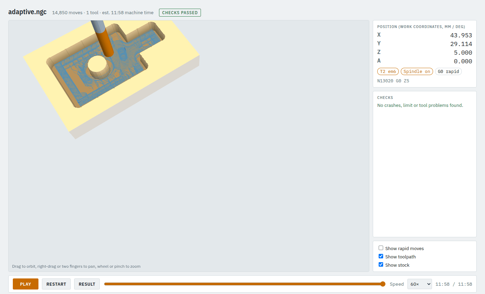
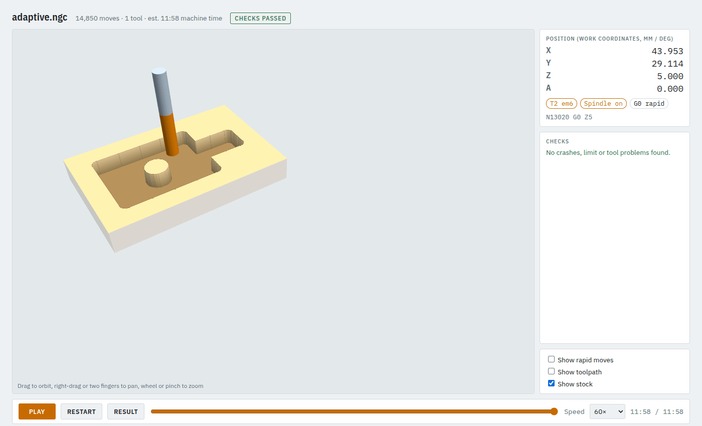

# 5. Clearing a deep pocket in aluminium (adaptive)

An ordinary pocket starts with a full-width slot and overloads the cutter in every corner. Adaptive
clearing keeps the same small width of cut everywhere, so you can use the whole flute length as the
step-down. Use it for hard materials and deep pockets.

**Time:** 5 minutes. Example: `examples/adaptive_job.json`.

## Step 1: the job

```json
"material": "aluminium",
"stock": {"type": "box", "x": [0, 90], "y": [0, 60], "z": [-12, 0]},
"shapes": {
  "pocket": {"type": "difference",
             "a": {"type": "union", "shapes": [
               {"type": "rect", "x": 10, "y": 10, "w": 50, "h": 40},
               {"type": "rect", "x": 55, "y": 22, "w": 25, "h": 16}]},
             "b": {"type": "circle", "cx": 35, "cy": 30, "r": 6}}
},
"operations": [
  {"op": "pocket", "shape": "pocket", "tool": "em6", "method": "adaptive",
   "depth": 8, "step_down": 4, "stepover_ratio": 0.15, "feed": 1200, "plunge": 200}
]
```

The shape is a rectangle with a narrower arm, minus a round island the cutter has to go around.

- **`"method": "adaptive"`** switches the pocket to adaptive clearing.
- **`stepover_ratio: 0.15`** is the width of cut, here 15 % of the 6 mm cutter (0.9 mm), kept everywhere.
  0.1 to 0.25 is typical.
- **`step_down: 4`**: two levels of 4 mm. With a light width of cut this can be most of the flute length
  (the check warns if you go past it).

## Step 2: check and look

```bash
camcore check examples/adaptive_job.json -o out/adaptive --no-sim
```

Seen from above, the paths are smooth loops that hug the material instead of rings that step in:



What happens, in order:

1. **Entry:** each region is entered by a helix at its widest point, so the cutter never plunges.
2. **Clearing:** loops that keep the cut at `stepover_ratio` wide, climb milling; where a loop runs
   into the cleared area it moves on to the next spot beside the material.
3. **Levels:** the same plan is repeated at each step-down level.
4. **Walls:** each level ends with a pass along the walls.



If a region is too narrow for a helix, camcore clears it with ordinary loops and says so in a `note:`.

## When to use which

| | `"offset"` (default) | `"adaptive"` |
|---|---|---|
| Wood, MDF, plastics, shallow pockets | ✔ quicker program, fewer moves | |
| Aluminium, deep pockets, long tools | | ✔ constant load, full-flute step-down |
| Program size | small | large (this example: 14,850 moves) |

Next: [inlays](06-inlay.md).
