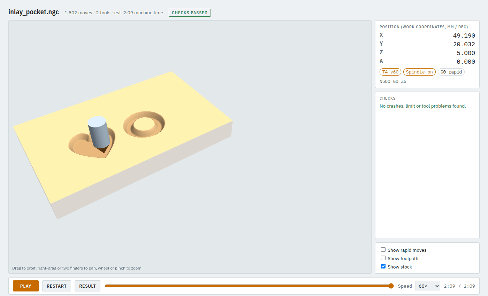
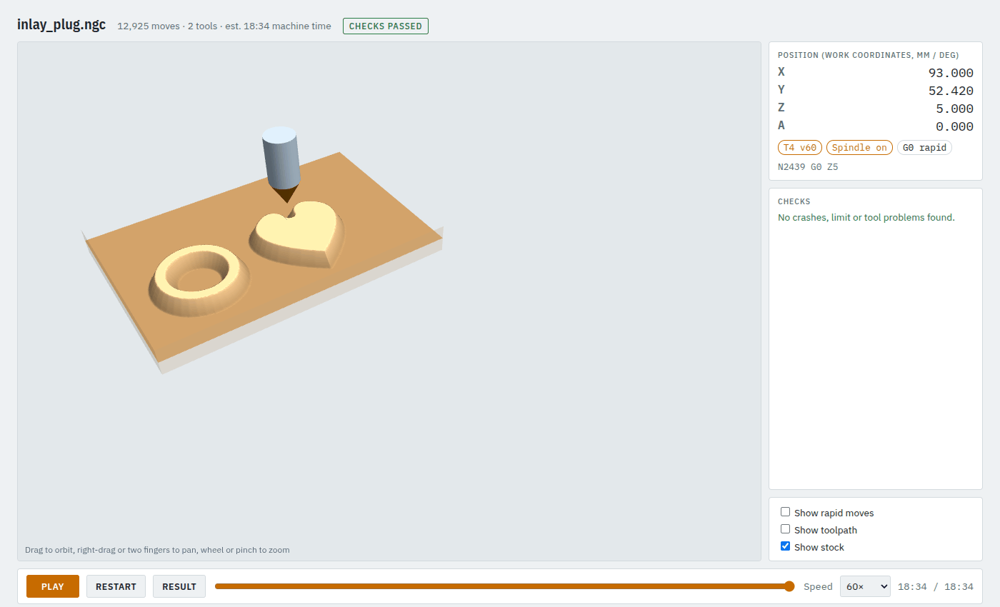

# 6. An inlay: one wood set into another

An inlay takes two programs from the same drawing: a **pocket** V-carved into the base board, and a
**plug** that stands up from the insert board, mirrored. The plug is turned over, glued into the
pocket, and the back of the insert board is planed off. camcore checks the fit before you cut.

**Time:** 20 minutes. Examples: `examples/inlay_pocket_job.json` and `examples/inlay_plug_job.json`.

## Step 1: two jobs, same numbers

The pocket job (base board, 160 x 100 x 18 mm):

```json
"stock": {"type": "box", "x": [0, 160], "y": [0, 100], "z": [-18, 0]},
"shapes": {"art": {"type": "svg", "file": "sign.svg", "fit_origin": [30, 20]}},
"operations": [
  {"op": "inlay", "part": "pocket", "shape": "art", "tool": "v60", "clear_tool": "em3",
   "pocket_depth": 5, "glue_gap": 0.5, "surface_gap": 1.5}
]
```

The plug job (insert board, 120 x 80 x 12 mm) differs in the stock, `part` and `fit_with`:

```json
"stock": {"type": "box", "x": [20, 140], "y": [10, 90], "z": [-12, 0]},
"shapes": {"art": {"type": "svg", "file": "sign.svg", "fit_origin": [30, 20]}},
"operations": [
  {"op": "inlay", "part": "plug", "shape": "art", "tool": "v60", "clear_tool": "em3",
   "pocket_depth": 5, "glue_gap": 0.5, "surface_gap": 1.5,
   "fit_with": "inlay_pocket_job.json"}
]
```

- **Same drawing, unmirrored, same place.** The plug job mirrors it for you.
- **Same V-bit and the same three numbers** in both jobs:
  - `pocket_depth`: how deep the pocket is (5 mm).
  - `glue_gap`: room for glue between the plug face and the pocket floor (0.5 mm).
  - `surface_gap`: the plug's flange stays this far above the base surface (1.5 mm), so clamp
    pressure goes into the walls, not the floor.
- **`clear_tool`** clears the pocket floor and the plug's flange flat. Where it does not fit (thin
  strokes, gaps between letters), the V-bit cuts those flat areas itself. An inlay always needs one. In the
  app it is the **Clear tool** field right under **Shape** in the operation's form, and **Fit with**
  below it names the pocket job on the plug.
- The V-bit must reach `pocket_depth - glue_gap + surface_gap` (here 6 mm) at its full diameter, or the
  job is refused.

## Step 2: check the pocket

```bash
camcore check examples/inlay_pocket_job.json -o out/inlay_pocket --no-sim
```



## Step 3: check the plug, with the fit

```bash
camcore check examples/inlay_plug_job.json -o out/inlay_plug --no-sim
```

Because the plug names the pocket job in `fit_with`, the check also simulates both programs, turns the
plug over onto the pocket, lowers it until it touches and measures:

```
checking the inlay fit against the pocket job...
verify: 12925 moves, 0 errors, 0 warnings
inlay fit: OK
  bottom gap 0.524 mm (glue_gap 0.5)
  flange gap 1.524 mm (surface_gap 1.5)
  plug face +0.024 mm from its design height (+ = stands proud, walls touch early)
  walls in contact (< 0.05 mm): 100% of wall cells, median wall gap 0.024 mm
  first touch near X49.2 Y23.0 (pocket job coordinates)
PASSED WITHOUT SIM
```

It fails if the bottom or flange gap is more than 0.1 mm off what you asked for, or if the walls do
not meet. The same numbers on their own: `camcore inlay-fit examples/inlay_pocket_job.json examples/inlay_plug_job.json`.



The plug board's flange is cleared over the whole board by default, so nothing needs trimming. With
`"plug_margin": 10` only 10 mm around the design is cleared (quicker); then trim the board inside that
flange before gluing.

## Step 4: cut, glue, plane

1. Run both final checks with the simulator (drop `--no-sim`) and cut both boards.
2. Spread glue in the pocket and on the plug walls.
3. Turn the plug over and press it in. The walls meet first; the face does not touch the floor.
4. Clamp across the whole plug with a caul and let it dry.
5. Plane or sand the back of the insert board down to the base surface.

**Try it in MDF first.** Wood moves, bits wear, and a real 60° bit is rarely exactly 60°. A test inlay
shows whether you need a slightly bigger `glue_gap`.

**Corners:** the default `"method": "medial"` gives sharp corners on both parts and needs a
centre-cutting V-bit. `"offset"` rounds sharp corners off, which keeps the plug from seating.

Next: [3D carving from an STL](07-3d-from-stl.md).
