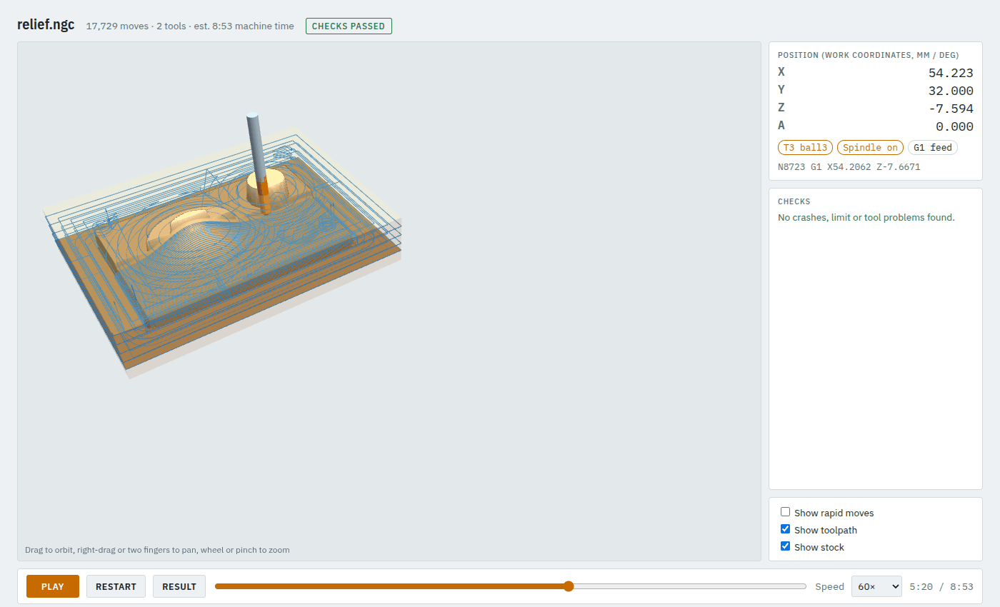
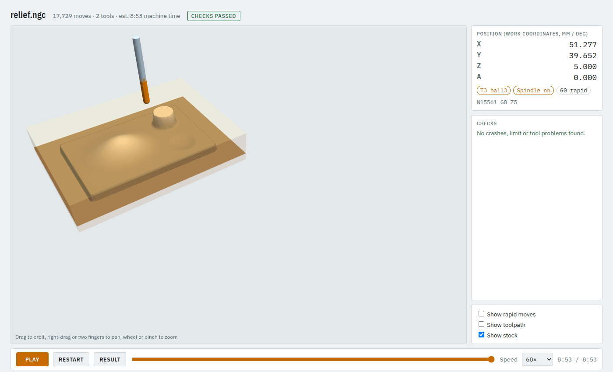

# 7. 3D carving from an STL (3 axes)

You will rough out a 3D model with an end mill and finish it with a ball-nose, from above, with
the three linear axes. Example: `examples/relief_job.json` with `examples/relief.stl`.

For a relief made from a **picture**, see [tutorial 11](11-relief-designs.md); for a part turned on
the rotary axis, [tutorial 10](10-rotary-from-stl.md).

**Time:** 10 minutes.

## Step 1: the model

Export a **closed (watertight)** STL in millimetres. Its top is cut from above, so it must not have
overhangs that you expect to be cut.

```json
"material": "hardwood",
"stock": {"type": "box", "x": [0, 80], "y": [0, 60], "z": [-15, 0]},
"models": {"relief": {"file": "relief.stl"}}
```

To place a model that is not already in stock coordinates, add to it:

- `"xy_start": [5, 5]`: its lowest X and Y go to that point,
- `"z_top": 0`: its highest point goes to that Z (0 = the stock top).

In the app: **Shapes & models → STL model…**.

## Step 2: rough, finish, walls

```json
"operations": [
  {"id": "rough", "op": "surface_rough", "model": "relief", "tool": "em6", "stock_to_leave": 0.5},
  {"id": "finish", "op": "surface_finish", "model": "relief", "tool": "ball3", "after": ["rough"],
   "strategy": "raster", "stepover": 0.5, "floor": -11.5},
  {"id": "walls", "op": "surface_finish", "model": "relief", "tool": "ball3", "after": ["finish"],
   "strategy": "waterline", "step_down": 0.3, "z_range": [-7, -1.5], "boundary": [50, 30, 66, 46]}
]
```

1. **`surface_rough`** clears level by level with the 6 mm end mill and leaves 0.5 mm everywhere
   (`stock_to_leave`). Step-down and stepover come from the tool's hardwood data.
2. **`surface_finish` raster** runs the 3 mm ball-nose back and forth across the whole model, 0.5 mm
   apart. Good on gentle slopes.
3. **`surface_finish` waterline** follows the model at constant heights, 0.3 mm apart, here only on the
   steep round boss (`boundary` = `[x0, y0, x1, y1]`, `z_range`). Good on steep walls, where a raster
   leaves wide steps.

`"after"` keeps the order even if you turn on `"tool_order": "minimize_changes"`.

## Step 3: check and look

```bash
camcore check examples/relief_job.json -o out/relief --no-sim
```

Part way through the raster finish, the roughed steps are being smoothed out:



The finished result:



3D jobs are large: this one is 17,729 moves. Compare the result with your model in the viewer: the
check replays every move against the stock and the machine, but it does not know what the part
should look like.

## Tips

- **Smoother finish:** a smaller `stepover` (0.2 to 0.3 mm with a 3 mm ball). Time grows with it.
- **Finishing without roughing** breaks small ball-noses in deep models. Always rough first.
- **Accuracy:** `sampling` (0.2 mm) is the spacing the model is probed at; `tolerance` (0.005 mm) is how
  far a finishing path may stray from the computed surface.
- **Slow on a big model?** Use `boundary` to finish only where needed.

Next: [wrapping a job around a cylinder](08-wrapped-rotary.md).
