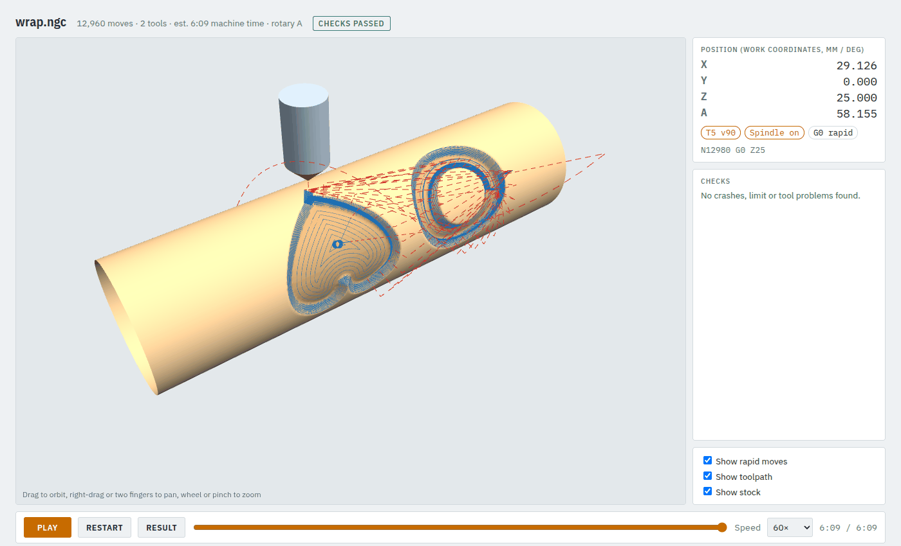

# 8. Wrapping a flat job around a cylinder

A wrapped job is an ordinary 2.5D job (pockets, profiles, V-carves) drawn flat and rolled around a
round blank in the A axis: **Y on the drawing becomes the angle A**. Use it for lettering on a
handle, a pattern around a rolling pin, flutes on a column.

**Time:** 10 minutes. Example: `examples/wrap_job.json`.

## Step 1: think of the drawing as the unrolled surface

On a 40 mm cylinder the surface is π x 40 = **125.7 mm around**. So in the drawing:

- **X** runs along the cylinder (along the rotary axis),
- **Y** runs around it: Y 0 to 125.7 mm is one full turn. Y 31.4 mm is a quarter turn (90°).

Draw at the real size of the surface. Anything beyond 125.7 mm in Y overlaps the start.

## Step 2: the job

```json
"stock": {"type": "cylinder", "diameter": 40, "x": [-30, 120], "chuck_hold": 15},
"rotary": {"diameter": 40},
"shapes": {
  "art": {"type": "svg", "file": "sign.svg", "fit_origin": [10, 20]}
},
"operations": [
  {"op": "vcarve", "shape": "art", "tool": "v90", "step": 0.2, "feed": 900, "max_depth": 2.5,
   "clear_tool": "em3", "clear": {"stepover_ratio": 0.45, "feed": 1000}}
]
```

- **`stock`**: a cylinder, 40 mm across, from X -30 to X 120. **`chuck_hold: 15`**: the first 15 mm are
  in the chuck jaws, so the jaw face is at X -15.
- **`"rotary": {"diameter": 40}`** wraps every operation around a 40 mm cylinder. Depths are measured
  from its surface, as on a flat job.
- **`fit_origin: [10, 20]`**: the drawing starts 10 mm along from X0 and 20 mm (about 57°) around.
- The operations are exactly what they would be on a flat board.

## Step 3: check and look

```bash
camcore check examples/wrap_job.json -o out/wrap --no-sim
```



The header says *rotary A*. The viewer turns the stock with A as the program plays. The red dashed
lines are rapid moves; the tool goes up to `safe_z` above the surface before A turns.

## Step 4: on the machine

Rotary jobs are set up differently from flat ones:

- **Z0 and Y0 are on the rotary axis centreline**, not on the stock top.
- **X:** set G54 so that the chuck's jaw face reads **X = `x[0]` + `chuck_hold`**; here -30 + 15 =
  **X -15**. The check and the simulator assume exactly this (from the jaw face position in the
  machine profile).
- Leave enough stock out of the jaws: the check knows the size of the chuck and the spindle and refuses
  programs that would bring them together. On the current machine profile the spindle needs about
  30 mm between the jaw face and the closest tool position.

See [tutorial 12](12-simulator-and-machine.md) for running it in the simulator first.

## Wrapped, indexed or continuous?

| You want | Use |
|---|---|
| A flat drawing around a round blank | **wrapped** (this tutorial) |
| Flat work on 2, 3, 4 ... faces of a square bar | [indexed 3+1](09-indexed.md) |
| A turned or carved 3D shape (chess piece, handle) | [rotary from STL](10-rotary-from-stl.md) |

Next: [indexed 3+1](09-indexed.md).
