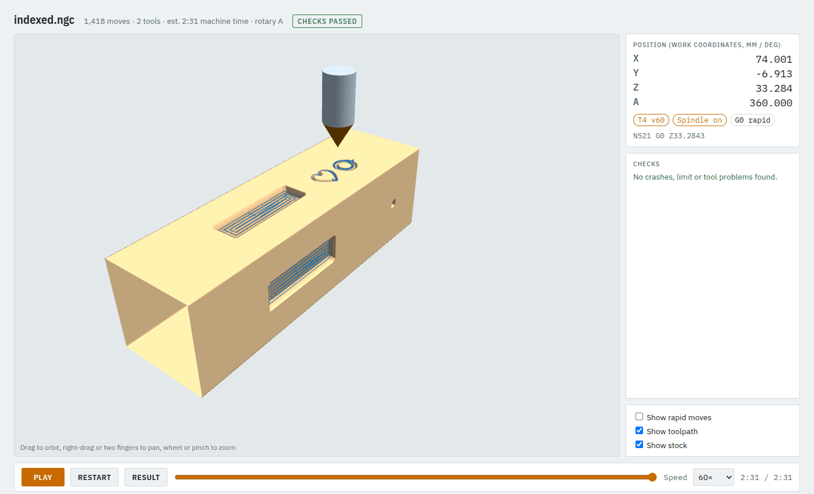

# 9. Indexed 3+1: the same work on several faces

Indexed work turns the part to a fixed angle, cuts like a flat job, turns to the next angle and
cuts again. You write each operation once, as for one face, and say on which angles it runs.

**Time:** 10 minutes. Example: `examples/indexed_job.json`, a 40 x 40 mm square bar.

## Step 1: the stock and the faces

```json
"stock": {"type": "bar", "x": [-20, 120], "y": [-20, 20], "z": [-20, 20], "chuck_hold": 15},
"index": {"sides": 4},
"tool_order": "minimize_changes"
```

- **`bar`**: a square bar along X, its cross-section at A = 0 given by `y` and `z` around the axis.
  15 mm of it is in the chuck.
- **`"index": {"sides": 4}`**: every operation runs on four faces, A = 0°, 90°, 180°, 270°. Also
  possible: one angle (`90`), a list (`[0, 180]`).
- **`tool_order: "minimize_changes"`**: run everything that uses one tool before changing tools,
  face by face.

## Step 2: draw each operation for one face

Each face is drawn as if it were a flat job seen from above: **X along the bar, Y across the face**
(here -20 to 20, centred on the axis), **Z0 on the face**, depths below it as usual.

```json
"shapes": {
  "slot": {"type": "rect", "x": 15, "y": -6, "w": 40, "h": 12},
  "art":  {"type": "svg", "file": "sign.svg", "scale": 0.3, "fit_origin": [66, -9]}
},
"operations": [
  {"id": "slots", "op": "pocket", "shape": "slot", "tool": "em3", "depth": 3},
  {"id": "holes", "op": "drill", "tool": "em3", "points": [[100, 0]], "depth": 8, "peck": 2,
   "index": [90, 270]},
  {"id": "label", "op": "vcarve", "shape": "art", "tool": "v60", "step": 0.15, "max_depth": 1.5,
   "index": [0]}
]
```

- **slots** has no `index` of its own, so it takes the job's: a slot on all four faces.
- **holes** overrides it: only on the faces at 90° and 270°.
- **label**: a small V-carved drawing on the 0° face only.
- For a face that is not at the stock's top (a step, a flat on a round bar), set `"face_z"` on the
  operation.

## Step 3: check and look

```bash
camcore check examples/indexed_job.json -o out/indexed --no-sim
```



Between faces the tool goes up above the whole bar (plus `index_clearance`, 5 mm by default), then
only A turns, then it comes down on the next face. While cutting a face, A does not move.

## Step 4: on the machine

The same as a wrapped job ([tutorial 8](08-wrapped-rotary.md#step-4-on-the-machine)): Y0 Z0 on the
rotary axis, the jaw face at X = `x[0]` + `chuck_hold` (here -5), and **A0 with the bar's faces level**
(the face at A = 0 pointing up).

Next: [rotary from STL and the wizard](10-rotary-from-stl.md).
