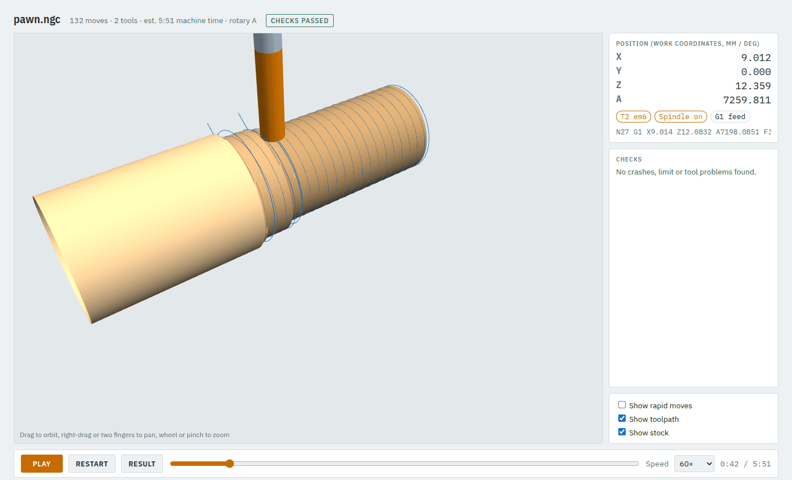
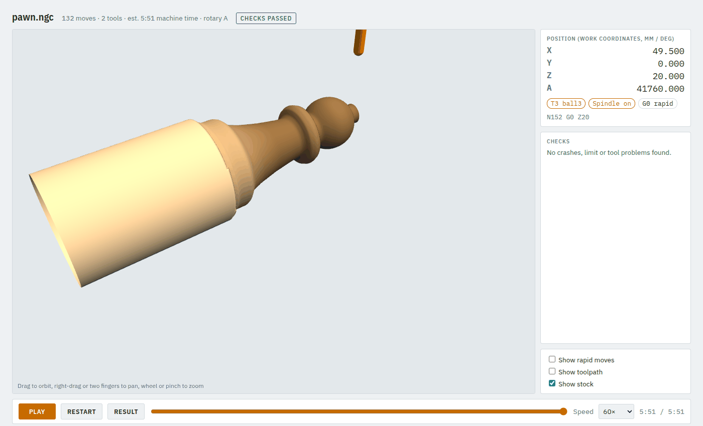
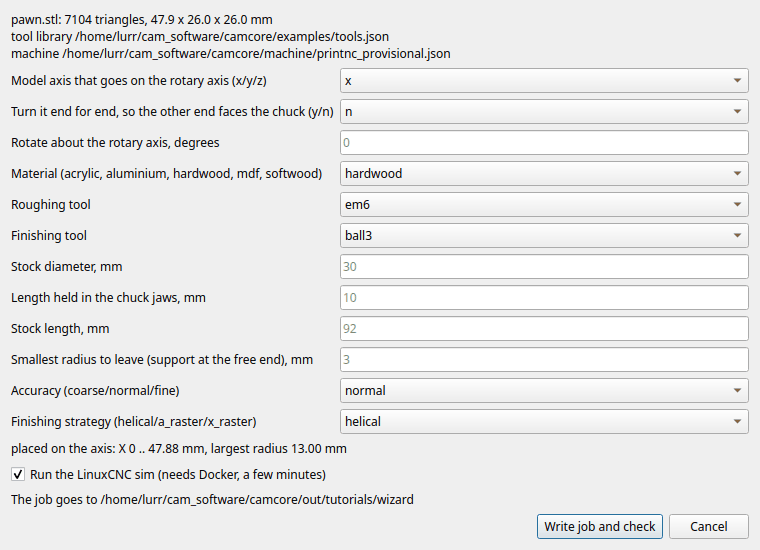
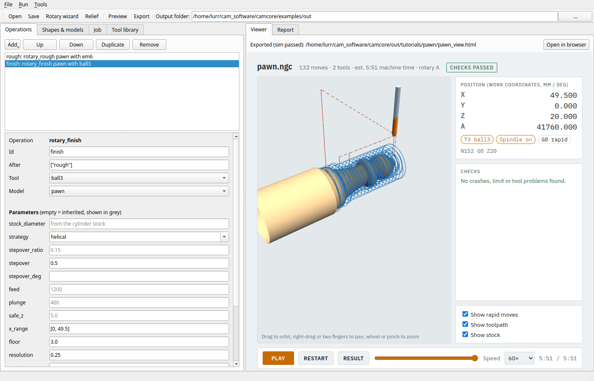

# 10. Turned and carved parts from an STL (rotary wizard)

For chess pieces, handles, knobs and other parts shaped all the way round, camcore roughs and
finishes an STL model while the A axis turns continuously. The **rotary wizard** asks a few questions
and writes the job for you. Example: `examples/pawn.stl`, a 48 mm pawn.

**Time:** 15 minutes.

## Step 1: run the wizard

```bash
camcore rotary-wizard examples/pawn.stl
```

Each question shows a suggested answer in brackets; **Enter** takes it.

```
model examples/pawn.stl: 7104 triangles, 47.9 x 26.0 x 26.0 mm (X x Y x Z)
tool library examples/tools.json, machine machine/printnc_provisional.json
Model axis that goes on the rotary axis (x/y/z) [x]:
Turn it end for end, so the other end faces the chuck (y/n) [n]:
Rotate about the rotary axis, degrees [0]:
placed on the axis (bounding box centred): X 0 .. 47.88 mm, largest radius 13.00 mm
Material (acrylic, aluminium, hardwood, mdf, softwood) [hardwood]:
  ball3    T3  3 mm ball
  em3      T1  3.175 mm flat
  em6      T2  6 mm flat
Roughing tool [em6]:
Finishing tool [ball3]:
Stock diameter, mm [30]:
Length held in the chuck jaws, mm [10]:
Stock length, mm [92]:
Smallest radius to leave (support at the free end), mm [3]:
Accuracy (coarse/normal/fine) [normal]:
Finishing strategy (helical/a_raster/x_raster) [helical]:
wrote out/pawn_job.json (edit it and run `camcore check out/pawn_job.json` to change anything)
```

What the questions mean:

| Question | What to answer |
|---|---|
| Model axis | which axis of your model lies along the rotary axis; the suggestion is its longest one |
| End for end | `y` if the wrong end would face the chuck |
| Rotate | turns the model about the axis, e.g. to put a flat side up |
| Material, tools | from your tool library |
| Stock diameter | the blank you will clamp; at least twice the largest radius |
| Held in the jaws | how much of the blank the chuck grips |
| Stock length | the suggestion keeps the spindle clear of the chuck jaws; shorter is refused |
| Smallest radius | a stub left at the free end so the part stays attached; cut it off by hand. It cannot be smaller than the flutes reach |
| Accuracy | `coarse` for a quick look, `normal`, `fine` for the final part |
| Finishing strategy | `helical` (one continuous spiral, smoothest), `a_raster` (rings), `x_raster` (lines along the axis) |

Then it runs `camcore check` on the new job (with the simulator, a few minutes) and opens the viewer.
For a quick look add `--no-sim`. To skip the questions, give the answers as options and `--yes` takes
the suggestion for the rest:

```bash
camcore rotary-wizard my_part.stl --yes --diameter 40 --preset fine --no-sim
```

## Step 2: look at it

Roughing: the 6 mm end mill takes the blank down in steps, leaving 0.5 mm.



The finished pawn on its stub, with the part of the blank in the chuck on the left:



## The same wizard in the desktop app

**Tools → Rotary wizard…** asks for the STL and where to save the job, then shows the same questions
as one form, with the same suggestions and checks:



**Write job and check** writes the job, opens it in the app and checks it (untick the sim box for a
quick look).

## Step 3: change the job

The wizard writes an ordinary job (`out/pawn_job.json`), so you change it like any other: in a text
editor, or in the app:



The two operations:

```json
"stock": {"type": "cylinder", "diameter": 30, "x": [-45, 50], "chuck_hold": 10},
"models": {"pawn": {"file": "pawn.stl"}},
"operations": [
  {"id": "rough", "op": "rotary_rough", "model": "pawn", "tool": "em6",
   "x_range": [0, 51], "floor": 3.0, "stock_to_leave": 0.5, "resolution": 0.5},
  {"id": "finish", "op": "rotary_finish", "model": "pawn", "tool": "ball3", "after": ["rough"],
   "strategy": "helical", "stepover": 0.5, "x_range": [0, 49.5], "floor": 3.0, "resolution": 0.25}
]
```

- **`x_range`**: the part of the model to cut, along X.
- **`floor`**: the smallest radius cut (the stub).
- **`stepover`**: smaller for a smoother finish (0.3 mm), at the cost of time.
- **`resolution`**: how finely the model is sampled. The wizard's Accuracy answer sets it, together
  with `stepover` and `stock_to_leave` (`fine`: 0.25 / 0.15 mm instead of 0.5 / 0.25 mm).

Check again after a change: `camcore check out/pawn_job.json -o out/pawn`.

## On the machine

As for every rotary job ([tutorial 8](08-wrapped-rotary.md#step-4-on-the-machine)): Y0 Z0 on the rotary
axis, the jaw face at X = `x[0]` + `chuck_hold` (for the pawn: -45 + 10 = X -35).

Next: [relief designs from a picture](11-relief-designs.md).
