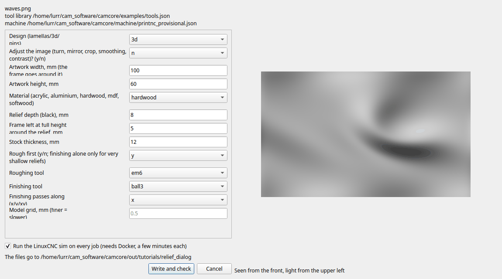
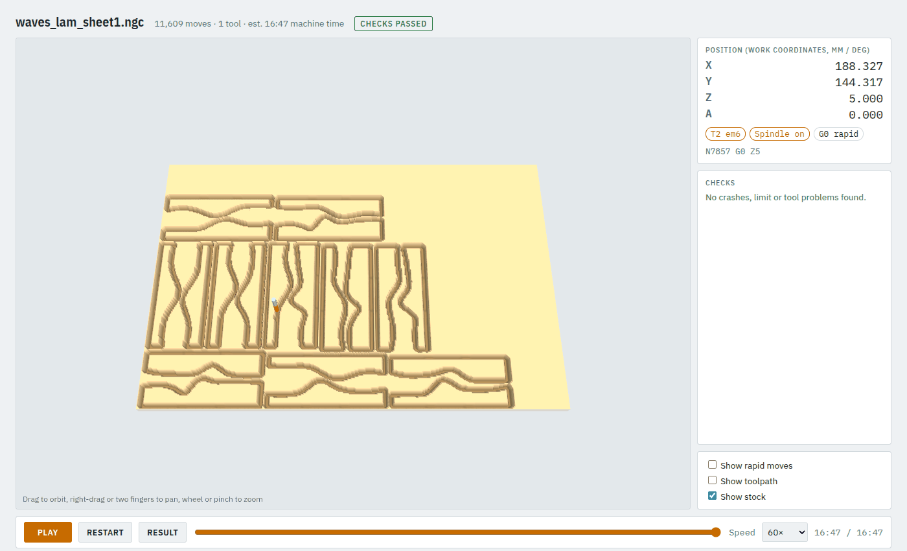
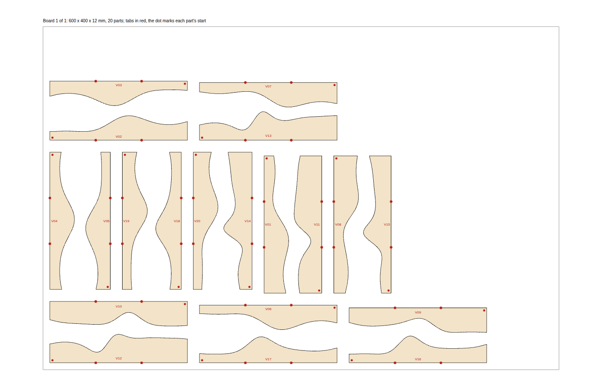
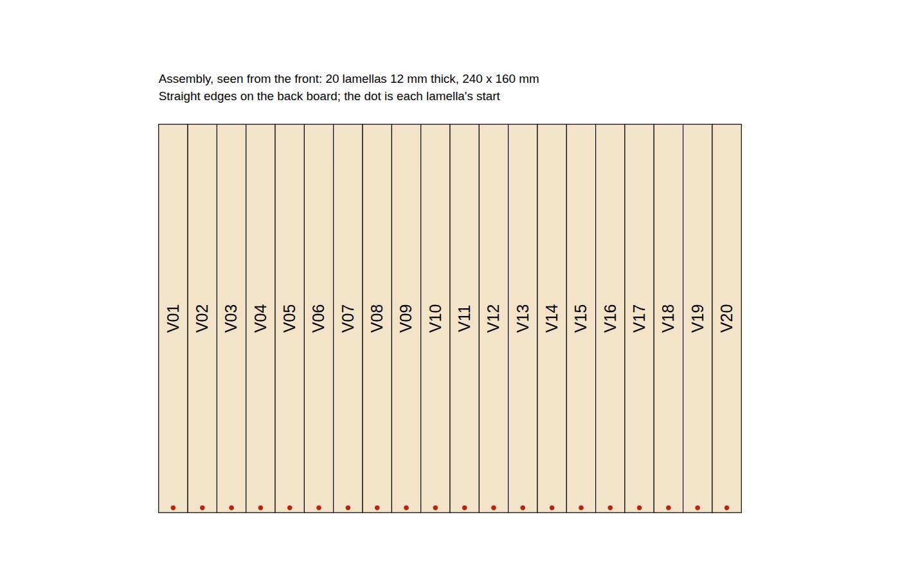
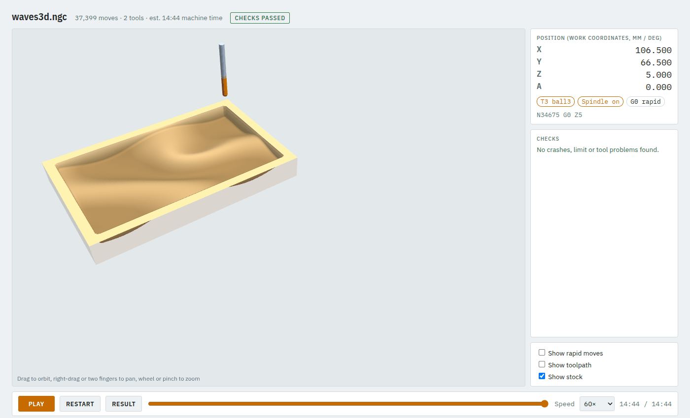
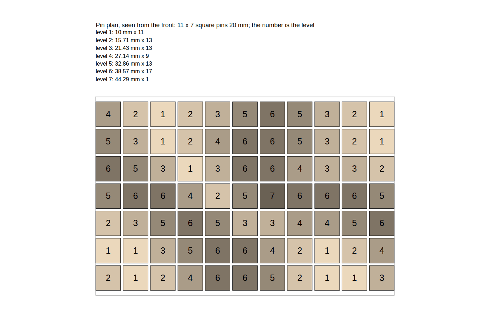

# 11. Relief designs from a picture: lamellas, 3D relief, pins

`camcore relief` turns a picture (bright = high) or an STL into wall art, in one of three designs:

| Design | What you get | Machining |
|---|---|---|
| **Lamellas** | strips standing on edge side by side on a back board; each strip's top follows the relief | one job per board: the strips cut out with tabs |
| **3D relief** | the relief milled as a surface into a board, with an optional frame | one job: roughing with an end mill, finishing with a ball-nose |
| **Pins** | a grid of pins cut to a few lengths | none: a cut list, a position list and a plan |

It asks questions, writes ordinary jobs plus the paperwork, and runs `camcore check` on every job.
The example picture is `examples/relief/waves.png`.

**Time:** 20 minutes.

## Step 1: the picture

Any PNG, JPEG, TIFF, BMP or WebP; 16-bit greyscale gives smoother slopes than 8-bit. **White is
high, black is low**, transparent is low. A depth map exported from a 3D program works best; a photo
works if light and dark really mean high and low. For an STL, `--view` says where it is seen from:
`z` (above, default), `y` (front) or `x` (side).

## Step 2: answer the questions

```bash
camcore relief examples/relief/waves.png -o out/waves
```

```
Design (lamellas/3d/pins) [lamellas]:
Adjust the image (turn, mirror, crop, smoothing, contrast)? (y/n) [n]:
Artwork width, mm [600]: 240
Artwork height, mm [400]: 160
Material (acrylic, aluminium, hardwood, mdf, softwood) [hardwood]:
Lamellas run (v = top to bottom, h = side to side) [v]:
Board thickness = lamella thickness, mm [18]: 12
Gap between lamellas, mm [0]:
Height of the lowest point (black), mm [15]: 10
Extra height for white, mm [60]: 25
Cutting tool [em6]:
Board width (machine X), mm [1000]: 600
Board depth (machine Y), mm [600]: 400
Parts may turn 90 deg on the board (grain across) (y/n) [y]:
Interlock parts head to tail to save board (y/n) [n]: y
Holding tabs per part (on its bottom edge) [2]:
wrote the design into out/waves
checking waves_sheet1_job.json ...
```

Enter takes the suggestion in brackets. Answer **y** to *Adjust the image* to turn, mirror, crop or
stretch it, smooth it (in mm), set its black and white point, gamma, or invert it (dark = high).
Every question has a flag (`camcore relief --help`), and `--yes` takes the suggestion for every
question you leave out. These three commands make the examples on this page:

```bash
# lamellas: 240 x 160 mm of 12 mm strips, 10 mm + 25 mm high, on 600 x 400 mm boards
camcore relief examples/relief/waves.png -o out/waves --yes --name waves_lam --mode lamellas \
  --width 240 --height 160 --thickness 12 --base 10 --relief 25 \
  --board-width 600 --board-height 400 --interlock y

# 3D relief: 100 x 60 mm, 8 mm deep, 5 mm frame, in a 12 mm board
camcore relief examples/relief/waves.png -o out/waves --yes --name waves3d --mode 3d \
  --width 100 --height 60 --depth 8 --thickness 12 --frame 5

# pins: 20 mm square pins, 2 mm apart, 10 to 50 mm long in 8 lengths
camcore relief examples/relief/waves.png -o out/waves --yes --name waves_pins --mode pins \
  --width 240 --height 160 --shape square --size 20 --gap 2 --base 10 --relief 40 --levels 8
```

Add `--no-sim` for a quick look; the jobs are checked with the simulator otherwise (a few minutes each).

### In the desktop app

**Tools → Relief…** asks for the picture and an output folder, then shows the same questions as a
form, with a shaded preview that follows your answers (rows that don't apply to the design are hidden):



**Write and check** writes the files, opens the first job and checks every job in turn.

## Step 3: lamellas

For every board you get a job, `waves_lam_sheet1_job.json`, and its program if the check passes. With
**Show toolpath** off, the viewer shows the strips cut out of the board, each held by its tabs:



The paperwork, next to the jobs:

| File | What it is |
|---|---|
| `waves_lam_parts.csv` | every strip: length, heights, where it goes, which board, where on it, turned or not |
| `waves_lam_assembly.svg` | the artwork from the front, every strip labelled |
| `waves_lam_board1.svg` / `.dxf` | the parts on the board with labels and tabs |
| `waves_lam_height.png` | the prepared relief (white = high), to check which way up it is |

The board plan: tabs in red, and a red dot at each strip's start so you know which way round it goes.
With interlocking, strips are paired head to tail where that saves board:



The assembly plan says where each strip goes on the back board:



**Assembly:** cut the boards, break the strips off their tabs and sand the tabs flush (they are on the
bottom edge, the one that gets glued), then glue the strips onto the back board in order, V01 on the
left, each with its dot at the bottom.

Parts sit at least 2 x the tool diameter + 2 mm apart, so the scrap between two wavy edges stays
in one piece and nothing comes loose while cutting. Boards that do not fit the machine's travel, or
would sit on the ATC rack, are refused before any toolpath is made.

## Step 4: 3D relief

One job, `waves3d_job.json`, with the block as `waves3d.stl` (X0 Y0 at its front left, Z0 on the stock
top): `surface_rough` with the 6 mm end mill, then `surface_finish` with the 3 mm ball-nose.



The design is refused if the ball-nose would have to finish into fresh stock (a deep relief without
roughing), or if the roughing tool's flutes are shorter than the depth. It is an ordinary
3D job: [tutorial 7](07-3d-from-stl.md) explains its operations.

**Large reliefs take time:** about 35 minutes of toolpath calculation for 300 x 200 mm at the default
0.5 mm model grid. Try a coarser `--resolution` first.

## Step 5: pins

Nothing to machine: you cut the pins from bar stock with a saw. You get:

- `waves_pins_cut_list.csv`: per length, how many pins and how much bar, saw cuts included,
- `waves_pins_positions.csv`: every pin (A1, A2, ...; row A at the back) with its length,
- `waves_pins_pin_plan.svg` / `.dxf`: the grid with each pin's level:



## Change a design

The jobs are ordinary job files: open them in the app or an editor, change an operation (a finer
finishing stepover, other tabs) and check again. To change the design itself (size, heights, board),
run `camcore relief` again.

Next: [the simulator and the machine](12-simulator-and-machine.md).
