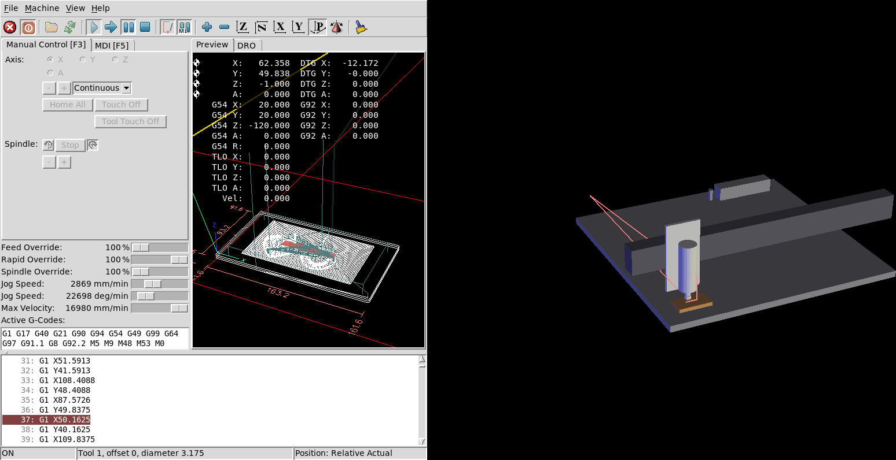
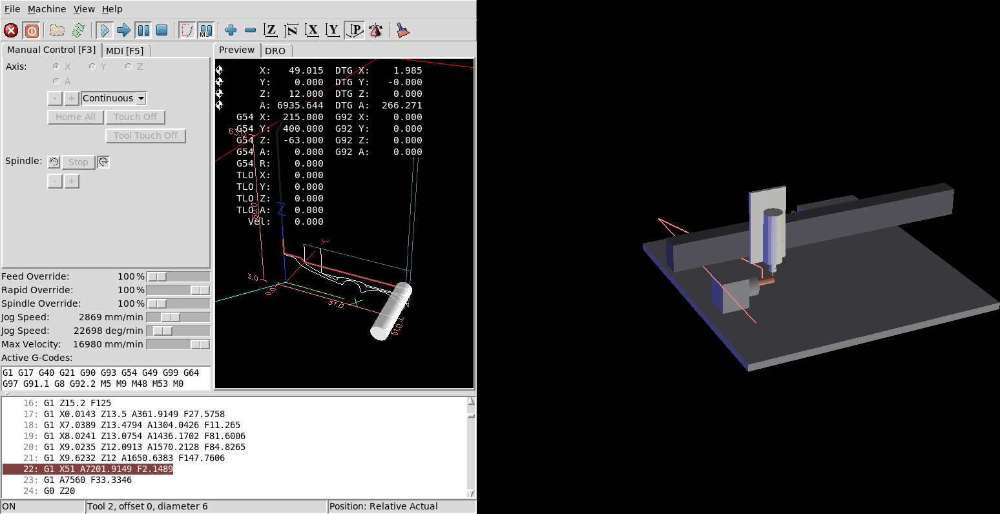

# 12. Watch it in LinuxCNC, then run it on the machine

`camcore check` already runs every program through LinuxCNC without a screen. This tutorial opens the
same simulated controller with its normal screen (AXIS) and a 3D model of the machine, so you can
watch the program the way you will on the PrintNC. Then it takes the program to the real machine.

**You need:** Docker and the `camcore-sim` image ([setup](../MANUAL.md#2-setup)), and a passed check
from [tutorial 1](01-first-job.md) in `out/sign`. **Time:** 15 minutes.

## Step 1: start the simulator

```bash
docker run --rm -p 6080:6080 -v "$PWD/out/sign:/work" camcore-sim gui /work/sign.ngc
```

Mount the output folder of a `camcore check` run (`-v ...:/work`) and name its program. The simulator
then uses the same machine settings, G54 and tool table the check used, and draws the machine model
from `sign_scene.json`.

Open **http://localhost:6080/vnc.html** in a browser and click **Connect**.

## Step 2: run the program in AXIS

1. **F1**: release the E-stop.
2. **F2**: switch the machine on.
3. **Home All** (Ctrl+Home): the simulated machine homes.
4. **Run** (R, or the blue triangle in the toolbar).



- **Left:** AXIS, as on the real controller: the program's preview with its extents, the position
  readout, and the G-code list with the current line highlighted.
- **Right:** the machine model: spoilboard, ATC rack, gantry beam, spindle with the tool, and the
  stock. It moves with the simulated axes.

A rotary job shows the rotary unit and the stock turning with A:

```bash
docker run --rm -p 6080:6080 -v "$PWD/out/pawn:/work" camcore-sim gui /work/pawn.ngc
```



Start the container with the program you want to watch: a rotary job's G54 differs from a flat job's.
Stop it with **Ctrl+C** in the terminal.

If the port is taken (`port is already allocated`), an older simulator is still running:
`docker ps`, then `docker stop <name>`.

## Step 3: take the program to the machine

1. **Copy** `out/sign/sign.ngc` (the file from a check that said `PASSED`) to the controller, e.g. with a
   USB stick into `~/linuxcnc/nc_files`, or
   `scp out/sign/sign.ngc <user>@<controller>:~/linuxcnc/nc_files/`.
2. **Open** it in AXIS: File → Open (Ctrl+O). The preview must look like the one in the simulator.
3. **Home** the machine and clamp the stock.
4. **Set G54** where the check assumed it:
   - flat jobs: X0 Y0 on the stock's front-left corner, Z0 on its top;
   - rotary jobs: Y0 Z0 on the rotary axis, and the chuck's jaw face at X = `x[0]` + `chuck_hold` from
     the job's stock ([tutorial 8](08-wrapped-rotary.md#step-4-on-the-machine)).

   The checks only mean something if G54 is where they assumed.
5. **Tools:** the program calls `Tn M6` with n = the ATC pocket from the tool library. The rack must
   hold those tools in those pockets.

## Step 4: prove each new kind of program

The check catches crashes into the stock and the machine model, limit and tool problems. It cannot know
a loose clamp, a wrong tool in a pocket or a G54 set a millimetre off. So for every new kind of program:

1. **Air cut:** set G54 Z 50 mm above the real stock and run the whole program. Watch the tool
   changes and A moves.
2. **Single block** (AXIS: the step button) through the first tool change and the first entry, with
   feed override at 25 %.
3. **Soft material** (MDF, foam) before the real stock.
4. **Hand on the E-stop** the first time each new operation type runs.

Next: [what to do when a check fails](13-when-a-check-fails.md).
