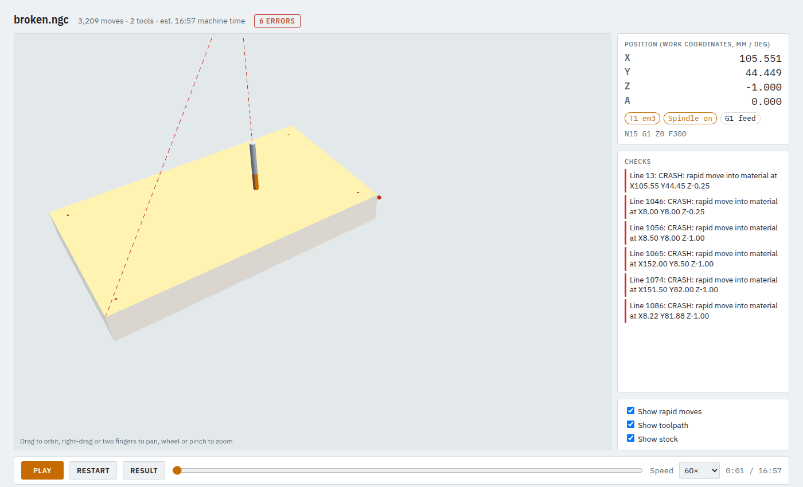

# 13. When a check fails

When `camcore check` finds a problem it writes **no program**, only a report that says what is wrong
and where. This tutorial breaks the sign job on purpose, finds the problem and fixes it.

**Time:** 10 minutes.

## Step 1: break it

Copy the sign job and set the rapid height **below** the stock top, a typo that would drive the tool
through the stock at full speed:

```bash
cp examples/sign_job.json examples/broken_job.json
```

In `examples/broken_job.json`: `"defaults": {"safe_z": -1.0, "ramp_angle": 3.0}`.

## Step 2: check it

```bash
camcore check examples/broken_job.json -o out/broken --no-sim
```

```
verify: 3209 moves, 6 errors, 0 warnings
  ERROR   line 13: CRASH: rapid move into material at X105.55 Y44.45 Z-0.25
  ERROR   line 1046: CRASH: rapid move into material at X8.00 Y8.00 Z-0.25
  ERROR   line 1056: CRASH: rapid move into material at X8.50 Y8.00 Z-1.00
  ERROR   line 1065: CRASH: rapid move into material at X152.00 Y8.50 Z-1.00
  ERROR   line 1074: CRASH: rapid move into material at X151.50 Y82.00 Z-1.00
  ERROR   line 1086: CRASH: rapid move into material at X8.22 Y81.88 Z-1.00
FAILED: camcore-verify found errors
report: out/broken/broken_report.txt
```

Each error gives the **G-code line**, what is wrong and **where** (work coordinates). The output folder
holds only `broken_report.txt`, the same text. In the app the same appears in the **Report** tab,
and the status bar says *FAILED: see the report*.

## Step 3: look at the failing program (when the message is not enough)

A failed check writes no viewer, but you can make the program and view it yourself. This program is
for looking only: it never goes to the machine.

```bash
camcore examples/broken_job.json -o out/broken/broken.ngc
echo '{"type": "box", "x": [0, 160], "y": [0, 90], "z": [-18, 0]}' > out/broken/stock.json
camcore-verify out/broken/broken.ngc --machine machine/printnc_provisional.json \
  --tools examples/tools.json --stock out/broken/stock.json --view out/broken/broken_view.html
```

`--stock` is the job's `stock`, copied into a file of its own. Open `out/broken/broken_view.html`. The
header shows the number of errors in red, and the **Checks** box lists them. **Click an error** to jump
to it: the slider moves there and the tool shows where it happens:



Here the tool sits at Z -1, inside the stock, on a rapid (G0) move: the rapid height is wrong.

## Step 4: fix it and check again

Set `"safe_z": 5.0` again and re-run the check. Errors usually come from one setting, so check
again after each fix rather than changing several things at once.

## Common errors

| Message | Usual cause and fix |
|---|---|
| `shape ... is completely off the stock` | the drawing keeps its own coordinates: set `fit_origin` on the shape (the message suggests one that centres it) |
| `CRASH: rapid move into material` | `safe_z` too low, or an operation's `top_z` below where the material really starts |
| `... is outside machine travel` | the part does not fit where G54 puts it; on rotary jobs the swing may be too large |
| `T.. plunges into material but is not marked center_cutting` | use `"entry": "ramp"` or `"helix"`, or mark the tool `center_cutting` if it really is |
| `COLLISION: collet nut hits chuck ...` | more stock out of the jaws (lower `x[0]` or `chuck_hold`), a longer tool (`gauge_length`), or keep the cut away from the chuck |
| `COLLISION: ... hits the stock` | the spindle comes down beside a deep cut: a longer tool, or a shallower cut |
| `rotary stock has no "chuck_hold"` | add it to the stock: mm held in the jaws |
| `tool ... has no cutting data for material ...` | add that material under the tool's `cutting`, or remove `material` from the job |
| `... contour(s) don't close ...` (DXF) | see [tutorial 3](03-own-drawings-and-cutouts.md#if-the-drawing-does-not-load) |
| `LinuxCNC sim: FAILED` | LinuxCNC itself refused the program; the report quotes its message and line |
| Python import errors, numpy mismatch | `unset PYTHONPATH` and `conda activate ./.conda` |

**Warnings** (cutting deeper than the flute length, a tool without `gauge_length`) do not stop the
program, but read them. **Notes** say where an operation adapted itself, e.g. fewer tabs.

More: [Troubleshooting in the manual](../MANUAL.md#12-troubleshooting).

**Never weaken a check to get a program out.** If you think a check is wrong, find out why first.
